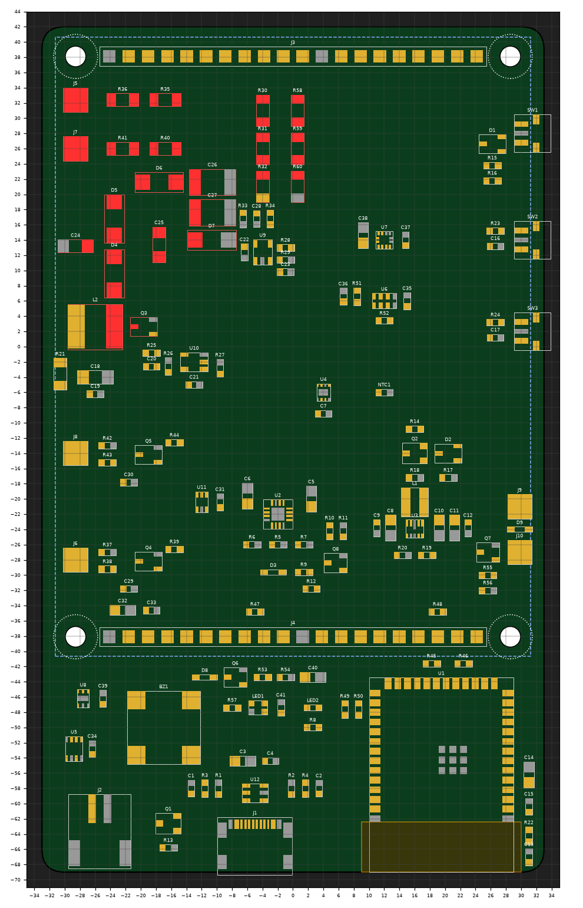
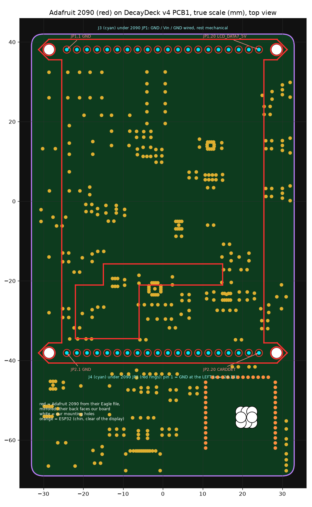

# DecayDeck v4 hardware

Dual-tube (STS-5 + SI-3BG) touchscreen Geiger counter. The design lives as code in this folder.
`design.py` is the netlist source of truth, and every other script builds or checks the EasyEDA project from it.
The EasyEDA project is **DecayDeck V4**, in the desktop client's local projects.

## Why v4 exists

The v3 board ("Geiger 3.0", PCB4) could not have worked:

1. **No high voltage at all.** Q1 MMBTA44 had its base wired to GND. Symbol pin 1 is B, and the PCB put pin 1 on GND.
2. **The "voltage doubler" was not a doubler.** It had no pump capacitor, so Q1 had to block the full 400 V at its 400 V rating.
3. **The 555 ran near 99.6 % duty.** There was no discharge resistor, and the base drive was an unlimited Darlington of roughly 1 A. The 1 mH inductor saturated.
4. **The firmware HV loop could not regulate.** It was bang-bang at 100 ms, which allows hundreds of volts of overshoot.

Lesser faults:

- The TP4056 CHG/STDBY LEDs back-powered the ESP32 from USB 5 V.
- The display Vin was on the battery, which pulled I²C to about 3.6 V.
- J3/J4 were male headers with nothing to mate with.
- The MAX17048 QSTRT pin was floating.
- The tube headers put 400 V across 0.5 mm.
- There was no BOOT button and no power path.

**Correction (2026-10-24).** An earlier version of this README listed "J4 was mirrored" as a v3 fault. That was
wrong: v3's J4 orientation was right. The 2090's back faces our board, so its JP2 pin 1 (GND) lands at x = −24.13 mm,
where v3 had it. v4 briefly had J4 rotated 180°, which would have put Vin on the SD-card CS pin. `overlay_2090.py` now
proves the fit from Adafruit's own board file (see Display below).

## Board

66 × 111 mm, 4 layers (Top signals, Inner1 GND, Inner2 3V3, Bottom signals), all parts on the top side.
The display covers the upper 81 mm. The chin below it holds the ESP32, USB-C, battery connector, buzzer, LEDs, light
sensor and BME280. Buttons are on the right edge. The tube wires land on 3.2 mm through-hole pads at the left edge,
next to the case's tube bay.

## Architecture

| Block | Parts | Notes |
|---|---|---|
| MCU | ESP32-S3-WROOM-1-N16R2 | 16 MB flash, 2 MB quad PSRAM (keeps IO35-37). In the chin, rotated 180° so the SPI/TFT pins face J4. The antenna sits at the bottom-right board edge over a copper-free keepout (no wires, fills, pours or planes). |
| USB-C in | TYPE-C-31-M-12, USBLC6-2SC6 | 5.1k Rd; CC1/CC2 tapped through 100k to ADC so firmware can read the source current rating. |
| Charger | BQ24075 | Power path (runs and charges at once). ISET 1.1k = 0.81 A, ILIM 1.3k = 1.24 A, TMR 56k = 7.5 h. EN1/EN2 from one GPIO: USB500 default, ILIM when CHG_FAST = 1. NTC on TS. |
| Battery | JST-PH S2B-PH-SM4-TB, AO3401A | Pad 1 = +, pad 2 = GND (silkscreen + and − beside them). Seen from the connector's open side, + is on the right, as on Adafruit's Feathers, so Adafruit and SparkFun LiPo plugs fit as they come. This was checked by pad geometry against two Adafruit board files (Feather ESP32-S3 and Feather nRF52840 Sense). An earlier check compared pad numbers only and had it reversed: Adafruit's footprint numbers its pads the other way round. The P-FET blocks a reversed cell when USB is not connected. MAX17048 fuel gauge. |
| 3V3 | TPS63802 buck-boost, XFL4015-471 | 511k / 88.7k: 3.38 V, keeping the WS2812 above its 3.3 V minimum. PG drives ESP_EN. Layout follows TI fig. 12-1. |
| Soft power | Q2 + 2×BAT54C | Button or USB PGOOD turns on the buck-boost EN. Firmware holds it with PWR_HOLD. Hold the button about 1 s to turn on. |
| HV | FMMT458, 1 mH, 3× US1M, 1 kV/2 kV caps | Boost plus doubler, so the switch sees about 200 V. TLV7011 compares HV_FB (301:1) with a PWM-RC reference (R28 100k / R29 75k: ceiling about 435 V); SN74LVC1G08 gates the PWM. Regulation is in hardware and does not stop if the firmware hangs. SMAJ440A clamp. 3×47 MΩ bleeder (about 2 s decay). |
| Tubes | STS-5 9.4 MΩ, SI-3BG 4.4 MΩ anode | Cathode-sensed: 220k load, BC847C, 74LVC2G17 Schmitt buffer, then PCNT. The tubes mount in the case's left bay. Anodes on J5 (STS-5) / J7 (SI-3BG), cathodes on J6 / J8. |
| Display | Adafruit 2090 on J4 (signals) + J3 (support), 1×20 female, 8.5 mm | Both headers sit in line with the 2090's mounting holes (y = ±38.1 mm). J4: Vin = 3V3; IM1-3 tied to the module's 3Vo and IM0 left on its pulldown, giving IM = 1110 (4-wire SPI), so no solder jumpers. J3 carries GND / Vin / GND (JP1 pins 1, 2, 12); JP1's other pins duplicate the parallel bus and are left open. Nylon M2.5 × 11 mm standoffs at the 4 holes (76.2 × 57.15 mm). |
| Sensors | BME280, RV-3032-C7, LIS2DH12, OPT3001 | I²C addresses 0x76, 0x51, 0x19, 0x44 (plus MAX17048 0x36 and touch 0x38). The OPT3001 and BME280 sit in the chin's left side, outside the display, for a case window and vent. |
| Outputs | MLT-8540H buzzer (pin 1 +), WS2812B-2020 RGB LED, red charge LED, coin motor pads (J9/J10) | 3 Alps SKRTLAE010 side buttons on the right edge (POWER, A/BOOT, B). Pads 1 and 3 are joined inside the switch (Alps circuit diagram), so only pad 3 is wired. Alps' land drawing prohibits copper between the front legs, and top-layer keepout regions (no wires, fills or pours) cover that area on all three. |

## Display fit and clearance (proven, not eyeballed)

The 2090's TFT is on Adafruit's bottom layer, and its microSD, buffers and regulator are on their top layer,
overlapping the glass area. So their top layer is the back of the display, facing our board, and our top view sees
the 2090 mirrored in x.

- `overlay_2090.py` reads Adafruit's Eagle board, applies the mirror and compares it with the live PCB. Result:
  40/40 header pins and 4/4 holes at 0.000 mm. Every J3/J4 net was checked against the signal Adafruit routes to
  that pin.
- `height_check.py` stacks every one of our 110 parts under the display against the 2090's underside parts. The
  gap is 11.0 mm nominal (8.5 mm socket + 2.5 mm header plastic) and 10.7 mm worst case.
  - Minimum clearance: **5.2 mm** (side buttons under the microSD socket).
  - Our tallest part (L2, 4.7 mm) stacked under a 3 mm allowance for the flex showing through the 2090's board
    cutout would still leave 3.0 mm.

## HV design rules

IPC-2221B table 6-1, 301-500 V, uncoated:

- 2.5 mm conductor-to-conductor (B2), plus to vias, through-hole pads, planes, holes and the board edge.
- Pads count as component terminations (A7): 1.5 mm from an SMD pad to a track, 1.4 mm pad to pad. Those two
  values exist so the parts' own footprints pass: 1206 pads sit 1.69-1.75 mm apart, and the FMMT458's collector is
  1.44 mm from its base.
- Placement still holds every HV pad 2.5 mm from every other part's pads.
- HV copper is hand-routed (`hv_route.py`), because EasyEDA's router only joins touching pads under a 2.5 mm class.
  Closest approach to other-net copper is 2.15 mm, against a 1.5 mm rule.
- The inner planes stay out from under the anode chains (stray capacitance on the high-impedance anode nodes).

## Firmware must-dos (hardware assumes these)

- Assert **PWR_HOLD (IO15)** first thing at boot. The power latch only holds once it is high.
- **RV-3032:** write EEPROM C0h with BSM = 10 (level switching mode). The factory default is 00, switchover disabled. DSM would lock out I²C, because the cell sits above the 3V3 rail. Keep TCM = 00, trickle charger off: the backup pin is the LiPo. Disable CLKOUT.
- **HV:** set HV_REF first, then start HV_PWM, and ramp up. The hardware ceiling is set by R28/R29. Run at about 400 V. The STS-5 works at 360-440 V (5-10 MΩ load) and the SI-3BG at 380-410 V, so one rail suits both. Keep the PWM on-time short enough that L2's peak current (3.38 V × t_on / 1 mH) stays well under its saturation current.
- **Charge-sleep mode:** while USB is present, 3V3 stays on (PGOOD). Hold IO17 (TFT_BL) low and IO18 (CHG_FAST) in deep sleep with GPIO hold.
- **Display rotation:** the 2090 is mounted with JP2 (the signal header) toward the chin. Pick the ILI9341 rotation so the image's top is the J3 end.
- There is no UART header. Flashing and console go over USB (USB-Serial-JTAG); hold A/BOOT (SW2, IO0) while plugging in for download mode.

## ESP32-S3 GPIO map

Generated from the module symbol's pin names and `design.py` (module pin in brackets).

| GPIO | Net | GPIO | Net | GPIO | Net |
|---|---|---|---|---|---|
| IO0 [27] | BTN_A (BOOT) | IO12 [20] | SPI_SCK | IO35 [28] | CHG_SNS |
| IO1 [39] | HV_FB_ADC (ADC1_0) | IO13 [21] | SPI_MISO | IO36 [29] | I2C_SDA |
| IO2 [38] | CC1_SNS (ADC1_1) | IO14 [22] | TFT_DC | IO37 [30] | I2C_SCL |
| IO3 [15] | CC2_SNS (ADC1_2) | IO15 [8] | PWR_HOLD | IO38 [31] | TOUCH_INT |
| IO4 [4] | GM1_OUT (STS-5) | IO16 [9] | PWR_BTN_SNS | IO39 [32] | SD_CS |
| IO5 [5] | GM2_OUT (SI-3BG) | IO17 [10] | TFT_BL | IO40 [33] | SD_CD |
| IO6 [6] | HV_PWM | IO18 [11] | CHG_FAST | IO41 [34] | TFT_RST |
| IO7 [7] | HV_REF_PWM | IO19 [13] | USB D− | IO42 [35] | BTN_B |
| IO8 [12] | BUZZER | IO20 [14] | USB D+ | IO47 [24] | LED_DATA |
| IO9 [17] | VIBRATE | IO21 [23] | RTC_INT | IO48 [25] | IMU_INT |
| IO10 [18] | TFT_CS (FSPICS0) | EN [3] | ESP_EN (TPS63802 PG) | | |
| IO11 [19] | SPI_MOSI | | | | |

- Unused: IO45 and IO46 (strapping pins, left open) and IO43/IO44 (UART0).
- SPI is on the FSPI IO_MUX pins.
- Every analog input is on ADC1, so readings keep working with WiFi on.

## Pipeline (run from this folder)

1. `check_spec.py`: resolves every net reference against the probed symbols (`probe_symbols.py`) and reports nothing as unresolved.
2. `build_sch.py layout|place|wire|titles`: builds the schematic. `swap_part.py` and `remove_part.py` handle part changes.
3. Import into the PCB (the owner clicks *Apply Changes*). Then `verify_pcb.py` checks the PCB netlist against the spec pin by pin.
4. `fetch_footprints.py` gets pad geometry, including rotated pads. It keeps a pad's hole only on multi-layer pads: some library SMD pads (the BQ24075 thermal pad, four USB-C pins) carry a leftover hole spec that EasyEDA ignores. `place_pcb.py check|push` does placement, and `verify_place.py` confirms the actual pads. `overlay_2090.py` and `height_check.py` prove the display fit.
5. `setup_board.py` makes the 4 layers, outline, holes and antenna keepout. `setup_rules.py` sets the HV class (above) plus power and HV track widths.
6. `fanout.py plan|push` adds the GND/3V3 plane vias. No via goes in the antenna keepout, and none under the module except its EPAD.
7. `hv_route.py push` lays the HV copper. `route.py rest` autoroutes everything else on Top + Bottom. `connectivity.py` checks every net is joined; it doesn't trust the router's own report.
8. `pours.py create` makes Inner1 GND, Inner2 3V3, outer GND, and the inner keepout under the anode chains. `rebuild_pours.py` fills them. The API can't fill pours it created, so the script sends the editor its own Shift+B. If the editor's copper worker has hung, the script saves the PCB, reopens the tab and retries. `fills.py` reads the poured copper back as geometry, and `connectivity.py --pours` checks every net against that real copper instead of assuming the planes join everything.
9. `drc.py` runs DRC; `fix_drc1.py` and `fix_drc2.py` hold the fixes it led to. `export_fab.py` writes the Gerber zip, BOM and CPL into `fab/<date>/`.
10. `fix_review.py check|apply` holds the pre-order review's two fixes (below). It edits PCB pad nets directly, so after it, `fetch_footprints.py` must be re-run before `connectivity.py` (which reads pad nets from `footprints.json`).

## Status (2026-10-25)

**Done**

- v3 audit.
- v4 architecture and parts, all stock-checked at JLC.
- Netlist spec, plus an independent review with all three findings fixed.
- Schematic: 149 parts, matches the spec. PCB: 149 parts, pin-for-pin match.
- Placement verified to 0.003 mm; 0 overlap / HV / keepout problems.
- Display fit and height clearance proven.
- Board, rules, plane fanout (142 vias), HV copper (hand-routed), low-voltage routing (autorouter).
- `connectivity.py`: every net with two or more pins is joined. BAT_ALRT is a deliberate single pin, the MAX17048's
  optional alert, left open because firmware polls the gauge over I²C.
- DRC round 1 (2026-10-25): fixed 3 duplicate mounting holes, an autorouted HV_DRV track squeezed 0.89 mm past Q3's
  collector (now re-routed on the bottom layer), and a 0.25 mm ground bridge (now 0.3 mm). Relaxed one rule entry:
  slot to SMD pad is 0.07 mm, for the SKRTLAE010 footprint's own boss holes.
- Pours filled (2026-10-25). Shift+B had been doing nothing: the editor's copper worker had hung ("buildCopper
  received no worker response"). Reopening the PCB tab fixed it, and `rebuild_pours.py` now does all of this itself.
- DRC round 2: the filled pours left one real fault. U2's (BQ24075) thermal pad had no vias, so it had no ground
  and no heat path. The cause was fanout skipping it as through-hole (the leftover hole spec above), after which the
  router ran BQ_EN2 and BQ_ILIM under it. `fix_drc2.py` re-routed those two nets around the pad, added the 2x2
  thermal vias, and tied the USB-C GND pins to their shell pads with 0.5 mm links (before, each had one 0.25 mm pour spoke).
- **DRC: 0 errors.** `connectivity.py` and `connectivity.py --pours` both report every net joined. An independent
  check of all poured copper against other-net tracks, vias and pads finds nothing closer than 0.15 mm.
- **Pre-order review (2026-10-25).** These are the things DRC can't see. Each was checked against the
  manufacturer's own document.
  - Pinouts: BQ24075, TPS63802, RV-3032-C7, LIS2DH12, OPT3001, TLV7011 and FMMT458 from their datasheets.
    MAX17048, BME280, ESP32-S3-WROOM-1, USBLC6, SN74LVC1G08, 74LVC2G17, the MOSFETs, BC847 and BAT54C against the
    symbol pin names. All match.
  - The charge timer constant (K_TMR 48 s/kΩ, so 56k = 7.5 h fast charge).
  - The WS2812B-2020-V6's supply range (3.3-5.3 V, so 3.38 V is in spec).
  - The SKRTLAE010 circuit diagram (1-3 common, 2 the other contact).
  - JLC stock for all 65 BOM lines (every line at 1,800 or more; 27 basic, 38 extended).
  - Two real faults found, both fixed by `fix_review.py`:
    1. **J2 battery polarity was reversed** for Adafruit/SparkFun cells (see the Battery row). Pads 1 and 2 swapped
       nets, BAT_RAW re-routed under the connector body to Q1, silkscreen +/− swapped.
    2. **The SKRTLAE010 no-copper area held copper.** Alps prohibits copper tracks between the front legs, and each
       button had its GND via and pour there. The GND vias moved behind the switches; pad 1 is no longer wired
       (it's pad 3 inside the switch), and top-layer keepouts now cover the areas.
  - Re-verified after the fixes:
    - DRC 0.
    - `verify_pcb.py` 438/438 pins.
    - `connectivity.py` and `connectivity.py --pours`: every net joined.
    - Fill clearance: nothing closer than 0.15 mm.
    - Placement 0 problems; the 2090 overlay 0.000 mm; height check PASS (5.2 mm).
- Exports in `fab/2026-10-25/` (re-exported after the review; the earlier set had the reversed battery), audited:
  - Gerber zip: 4 copper layers, both inner planes poured, and the outline.
  - Drill: 247 vias of 0.3 mm. Plated holes: 4 USB-C shell slots (0.8 x 1.2 / 1.5 mm), 40 header holes of 1.02 mm, 6 of 1.6 mm. Unplated: 4 mounting holes of 2.7 mm, 6 button bosses, 2 USB-C pegs. No stray hole under the U2 thermal pad or the USB-C pins.
  - BOM: 65 lines, 143 parts, every line with an LCSC number. J5-J10 are wire pads, so they're left out.
  - CPL: 149 rows, all on top.

**Next**

- Order at JLC with the settings under *Ordering* below.
- Bought separately:
  - A 1S LiPo with a JST-PH plug and a built-in protection circuit, 1000 mAh or more (charge current is 0.81 A).
    Adafruit or SparkFun cells plug in as they come. With any other brand, check that the red wire sits on the
    silkscreen + before plugging in.
  - A 3 V coin vibration motor (J9/J10).
  - Four nylon M2.5 × 11 mm standoffs and screws for the 2090.
  - Tube holders.
- Bring-up: Alps says don't clean the switches with solvent. If the HV area gets an IPA wash to clear flux (the
  100 MΩ divider is leakage-sensitive), keep it away from SW1-3.
- Case design: needs the tube end-cap measurements. Tube bay on the left, display window, light pipes for LED1/LED2, a window over the OPT3001, a vent by the BME280, a buzzer port, button caps, USB-C cutout, and plastic only near the antenna.
- Firmware rewrite: LVGL UI, PCNT counting, HV control, web UI.
- Case input: the USB-C front face stands 1.27 mm proud of the bottom board edge (HRO drawing: front face 2.60 mm
  ahead of the front shell legs), and the button actuators reach the right edge.

## Ordering (JLCPCB, one order)

Upload `fab/2026-10-25/DecayDeck_v4_Gerber.zip`, switch on PCB Assembly, then upload the BOM and CPL from the same
folder. JLC renames its options from time to time, so match these by intent.

**PCB**

| Option | Choice | Why |
|---|---|---|
| Layers / size / qty | 4, 66 × 111 mm (auto), 5 | |
| Thickness | 1.6 mm | What the USB-C shell legs and headers are made for |
| Stackup | JLC default (JLC04161H-7628) | No impedance control needed: USB is full speed only |
| Surface finish | **ENIG** | Flat pads for the QFN/LGA parts (BQ24075, TPS63802, BME280, LIS2DH12, OPT3001, MAX17048); HASL is lumpy |
| Solder mask | Green (or blue/purple), **not black** | Some black masks use carbon pigment, not wanted beside 400 V and 100 MΩ resistors |
| Copper | 1 oz outer, 0.5 oz inner (defaults) | |
| Via covering | **Tented** | Required: router vias sit under the ESP32 module |
| Mark on PCB | Remove | A clean board; otherwise JLC prints an order number |
| Confirm production file | **Yes** | You approve their processed Gerbers before fabrication |
| Electrical test | Flying probe (default) | |
| Everything else | Off (gold fingers, castellations, edge plating, impedance) | |

**Assembly**

| Option | Choice | Why |
|---|---|---|
| PCBA type | **Standard** | Handles the through-hole headers. JLC adds rails at the edge instead of drilling its own tooling holes into the board, as Economic can |
| Side / qty | Top, 5 | Spares cost far less than a second order |
| Edge rails / fiducials | Added by JLCPCB | The board is narrower than their line minimum. If their engineer asks, the USB-C and button overhangs are intended |
| Confirm parts placement | **Yes** | Check the preview: D1-D9, LED1, LED2 polarity; pin 1 of U1-U12; Q1-Q8; J1, J2 and BZ1 orientation |
| Board washing / conformal coating | **No** | Alps forbids solvent on the SKRTLAE010 buttons; coating would get into the buttons and connectors |
| CPL rows without a part | Do not place | J5-J10 are wire pads (the CPL has 149 rows, the BOM 143 parts) |

All 65 BOM lines match LCSC numbers that JLC stocks (1,800 or more of each on 2026-10-25). Any line JLC shows as
short when ordering needs a decision before paying, never an automatic substitute.
