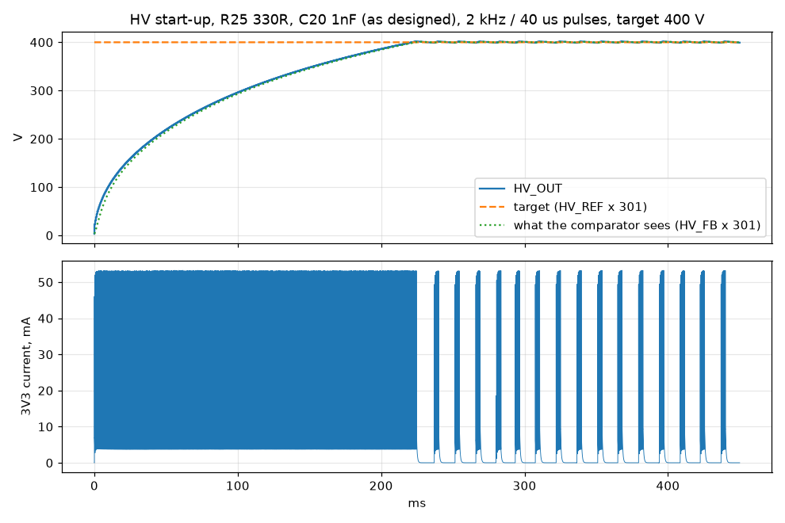
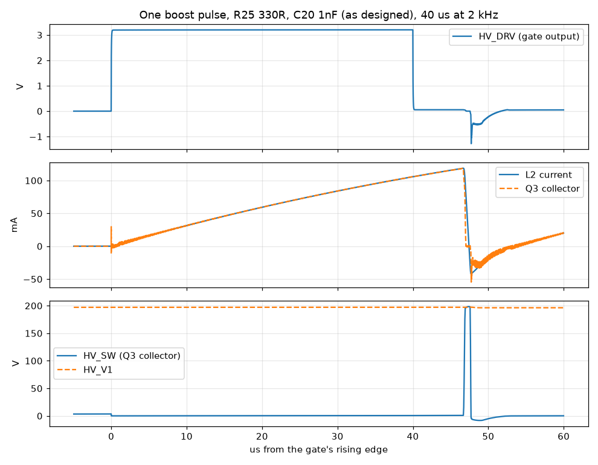
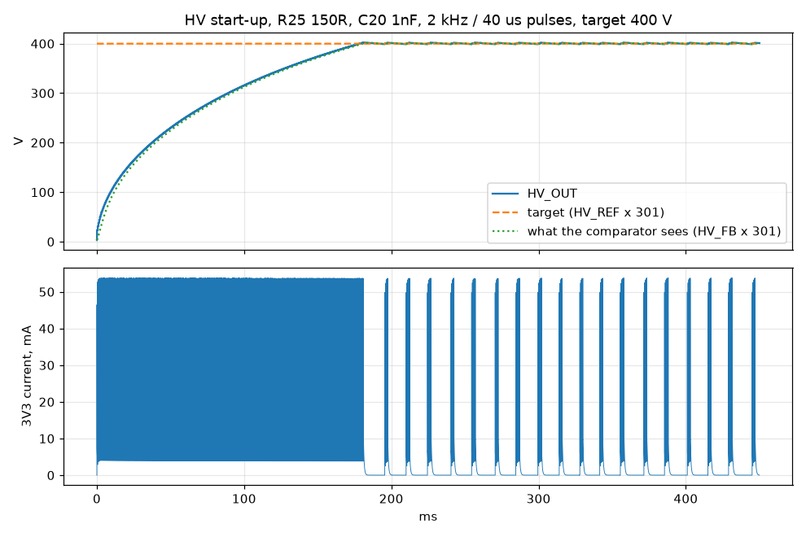
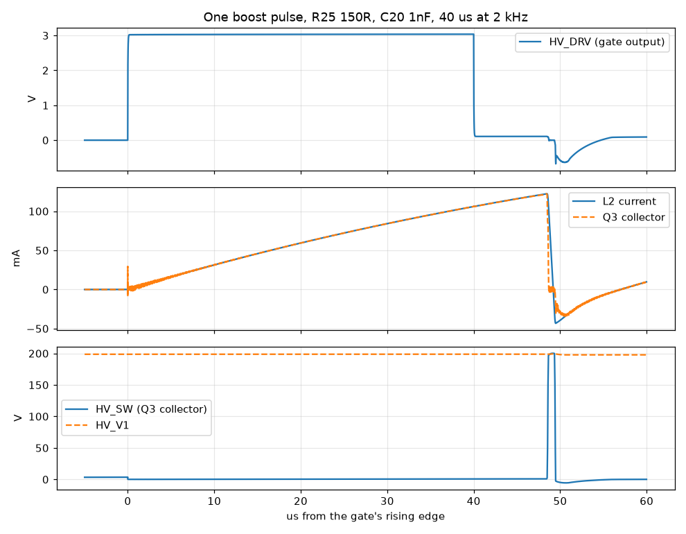

# Simulation results

Written by `report.py` from the last run of each bench. Currents are what the HV supply takes from the 3V3 rail, base drive included; the battery sees about the same divided by the buck-boost's ~90 % efficiency.

## Headline: the first design vs the board as built (R25 at 150 Ω)

Steady state at 400 V over a 160 ms window (enough pulses to trust the averages). Tubes connected, idle.

| Base drive | HV_PWM | 3V3 current | Efficiency | Ripple | Pulses used | False counts |
|---|---|---|---|---|---|---|
| R25 330R, C20 1nF (first design) | 5 kHz, 20 µs | 2.28 mA | 23 % | 2.5 V | 32 % | 0 |
| R25 330R, C20 1nF (first design) | 2 kHz, 40 µs | 1.63 mA | 31 % | 3.0 V | 24 % | 0 |
| R25 150R, C20 1nF (as built) | 5 kHz, 20 µs | 1.46 mA | 36 % | 3.0 V | 19 % | 0 |
| R25 150R, C20 1nF (as built) | 2 kHz, 40 µs | 1.32 mA | 39 % | 3.4 V | 18 % | 0 |

The sweep below uses a 30 ms window: at 2 kHz only a handful of pulses land in it, so differences under ~10 % between rows there are noise.

## HV supply at 400 V: base drive and pulse timing

Each row is a steady-state run at 400 V with both tubes connected and idle. *Pulses used* is the share of HV_PWM pulses the comparator lets through: the rest is headroom for high count rates.

| Base drive | HV_PWM | 3V3 current | Efficiency | Ripple | Pulses used | L2 peak | Q3 VCE peak | False counts |
|---|---|---|---|---|---|---|---|---|
| R25 330R, C20 1nF (first design) | 10 kHz, 10 µs | 6.46 mA | 10 % | 0.9 V | 100 % | 55 mA | 200 V | 0 |
| R25 330R, C20 1nF (first design) | 5 kHz, 20 µs | 2.43 mA | 22 % | 2.4 V | 33 % | 80 mA | 200 V | 0 |
| R25 330R, C20 1nF (first design) | 2 kHz, 40 µs | 1.59 mA | 31 % | 2.9 V | 23 % | 119 mA | 202 V | 0 |
| R25 330R, C20 1nF (first design) | 2 kHz, 60 µs | 1.60 mA | 32 % | 3.4 V | 13 % | 149 mA | 203 V | 0 |
| R25 330R, C20 1nF (first design) | 1 kHz, 100 µs | 1.92 mA | 29 % | 3.8 V | 20 % | 192 mA | 205 V | 0 |
| R25 150R, C20 1nF (as built) | 5 kHz, 20 µs | 1.41 mA | 36 % | 3.0 V | 19 % | 83 mA | 201 V | 0 |
| R25 150R, C20 1nF (as built) | 2 kHz, 40 µs | 1.34 mA | 38 % | 3.3 V | 18 % | 122 mA | 202 V | 0 |
| R25 150R, C20 1nF (as built) | 2 kHz, 60 µs | 1.03 mA | 44 % | 4.2 V | 8 % | 153 mA | 203 V | 0 |
| R25 100R, C20 1nF | 5 kHz, 20 µs | 1.39 mA | 37 % | 3.1 V | 17 % | 84 mA | 201 V | 0 |
| R25 100R, C20 1nF | 2 kHz, 40 µs | 1.34 mA | 39 % | 3.4 V | 17 % | 124 mA | 202 V | 0 |
| R25 100R, C20 1nF | 2 kHz, 60 µs | 1.52 mA | 39 % | 4.4 V | 12 % | 154 mA | 204 V | 0 |
| R25 330R, C20 4.7nF | 5 kHz, 20 µs | 3.97 mA | 15 % | 2.0 V | 61 % | 78 mA | 200 V | 0 |
| R25 330R, C20 4.7nF | 2 kHz, 40 µs | 2.10 mA | 25 % | 2.6 V | 32 % | 117 mA | 201 V | 0 |
| R25 330R, C20 4.7nF | 2 kHz, 60 µs | 1.93 mA | 27 % | 3.4 V | 18 % | 147 mA | 202 V | 0 |
| R25 150R, C20 4.7nF | 5 kHz, 20 µs | 1.49 mA | 32 % | 2.9 V | 20 % | 82 mA | 201 V | 0 |
| R25 150R, C20 4.7nF | 2 kHz, 40 µs | 1.24 mA | 36 % | 2.9 V | 17 % | 122 mA | 202 V | 0 |
| R25 150R, C20 4.7nF | 2 kHz, 60 µs | 1.64 mA | 37 % | 4.1 V | 13 % | 152 mA | 203 V | 0 |
| R25 100R, C20 4.7nF | 5 kHz, 20 µs | 1.38 mA | 36 % | 3.0 V | 17 % | 83 mA | 201 V | 0 |
| R25 100R, C20 4.7nF | 2 kHz, 40 µs | 1.33 mA | 38 % | 3.3 V | 17 % | 123 mA | 202 V | 0 |
| R25 100R, C20 4.7nF | 2 kHz, 60 µs | 0.94 mA | 32 % | 4.4 V | 7 % | 154 mA | 204 V | 0 |

## Start-up and one pulse: R25 330R, C20 1nF (first design)

- From 0 V: 95 % of 400 V in 191 ms, settling at 400.2 V with 1.7 V overshoot. Every pulse passes until 400 V, so the rise is the boost's own limit (the bench sets the target from t = 0; on the board HV_REF's 43 ms filter ramps it too).
- Steady: 400.3 V, 2.90 V ripple, 1.59 mA from 3V3, 31 % efficient; tube cathode pickup from the switching 12 mV (a count needs ~600 mV); 0 false counts.





## Start-up and one pulse: R25 150R, C20 1nF (as built)

- From 0 V: 95 % of 400 V in 156 ms, settling at 400.4 V with 2.1 V overshoot. Every pulse passes until 400 V, so the rise is the boost's own limit (the bench sets the target from t = 0; on the board HV_REF's 43 ms filter ramps it too).
- Steady: 400.5 V, 3.29 V ripple, 1.34 mA from 3V3, 38 % efficient; tube cathode pickup from the switching 15 mV (a count needs ~600 mV); 0 false counts.





## Faults: R25 330R, C20 1nF (first design)

| Case | HV max | Q3 VCE max | L2 peak | 3V3 draw | R21 | Q3 |
|---|---|---|---|---|---|---|
| firmware asks for the maximum (HV_REF at 100 %) | 438 V | 220 V | 119 mA | 2.0 mA | 0 mW | 3 mW |
| comparator dead, output stuck high (only the clamp limits HV) | 515 V | 254 V | 119 mA | 6.9 mA | 1 mW | 12 mW |
| firmware leaves HV_PWM high (GPIO stuck) | 400 V | 3 V | 228 mA | 160.0 mA | 256 mW | 142 mW |

## Faults: R25 150R, C20 1nF (as built)

| Case | HV max | Q3 VCE max | L2 peak | 3V3 draw | R21 | Q3 |
|---|---|---|---|---|---|---|
| firmware asks for the maximum (HV_REF at 100 %) | 438 V | 220 V | 123 mA | 2.0 mA | 0 mW | 2 mW |
| comparator dead, output stuck high (only the clamp limits HV) | 515 V | 257 V | 122 mA | 7.5 mA | 1 mW | 8 mW |
| firmware leaves HV_PWM high (GPIO stuck) | 400 V | 3 V | 230 mA | 167.6 mA | 281 mW | 141 mW |

## Faults: R25 100R, C20 1nF

| Case | HV max | Q3 VCE max | L2 peak | 3V3 draw | R21 | Q3 |
|---|---|---|---|---|---|---|
| firmware asks for the maximum (HV_REF at 100 %) | 438 V | 220 V | 124 mA | 1.5 mA | 0 mW | 1 mW |
| comparator dead, output stuck high (only the clamp limits HV) | 515 V | 257 V | 124 mA | 8.0 mA | 1 mW | 7 mW |
| firmware leaves HV_PWM high (GPIO stuck) | 400 V | 3 V | 231 mA | 172.8 mA | 299 mW | 141 mW |

Ratings: FMMT458 VCEO 400 V, 500 mW, base 200 mA; R21 0.5 W; L2 Isat 400 mA; SMAJ440A clamps from 492 V; SN74LVC1G08 output 24 mA recommended; STS-5 working 360-440 V, SI-3BG 380-410 V.

## Tube pulses (`gm.py`)

```
  tube C   tau    Vext | STS-5 pulses, widths (us)          | SI-3BG pulses | cathode peak, anode drop
     3p     2us   280 | 3    89.5,   89.5,   89.4       | 3             |  0.62 V, 111.5 V  ok
     3p     2us   340 | 3    59.4,   59.4,   59.4       | 3             |  0.62 V,  55.5 V  ok
     3p    10us   280 | 3    75.2,   75.2,   75.2       | 3             |  0.62 V,  88.0 V  ok
     3p    10us   340 | 3    37.8,   37.9,   37.9       | 3             |  0.61 V,  43.8 V  ok
     3p    50us   280 | 3    20.8,   20.8,   20.8       | 3             |  0.61 V,  40.2 V  ok
     3p    50us   340 | 0                               | 0             |  0.36 V,  20.1 V  missed (stress corner)
     6p     2us   280 | 3   132.8,  132.8,  132.8       | 3             |  0.63 V, 115.3 V  ok
     6p     2us   340 | 3    83.4,   83.4,   83.4       | 3             |  0.62 V,  57.4 V  ok
     6p    10us   280 | 3   118.4,  118.2,  118.4       | 3             |  0.62 V, 101.1 V  ok
     6p    10us   340 | 3    64.7,   64.7,   64.7       | 3             |  0.61 V,  50.3 V  ok
     6p    50us   280 | 3    59.3,   59.3,   59.3       | 3             |  0.61 V,  53.5 V  ok
     6p    50us   340 | 0                               | 3             |  0.47 V,  26.7 V  missed (stress corner)
    15p     2us   280 | 3   257.4,  258.8,  257.4       | 3             |  0.63 V, 117.7 V  ok
    15p     2us   340 | 3   149.4,  150.6,  149.3       | 3             |  0.62 V,  58.6 V  ok
    15p    10us   280 | 3   242.4,  244.3,  242.6       | 3             |  0.62 V, 111.0 V  ok
    15p    10us   340 | 3   131.5,  132.9,  131.5       | 3             |  0.62 V,  55.2 V  ok
    15p    50us   280 | 3   147.5,  151.2,  147.7       | 3             |  0.62 V,  66.0 V  ok
    15p    50us   340 | 0                               | 3             |  0.58 V,  32.8 V  missed (stress corner)
every case gives one clean pulse per count
```
